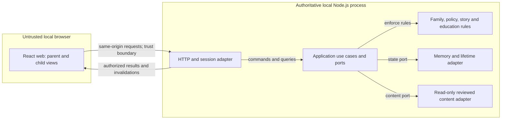

# Architecture

This specification owns how the unimplemented system is built. [REQUIREMENTS.md](REQUIREMENTS.md) owns behavior; [DESIGN.md](DESIGN.md) owns visual, interaction and frontend constraints. Recommendations below are **PROPOSED**, not implemented or confirmed choices.

## Required Architecture Inputs

| Field | Input |
| --- | --- |
| Requirements source | `REQUIREMENTS.md` |
| Design source | `DESIGN.md` |
| Architecture style | Hexagonal architecture (requested). |
| Target surfaces | Local browser web demo (NFR-3–4). Native mobile is not confirmed by requirements; see AQ-1. |
| Runtime and deployment environment | Node.js (developer input; version UNKNOWN). One local process serving UI/API only at `http://127.0.0.1:3000`; loopback binding only, no public hosting or remote proxy (NFR-3, NFR-7). Host OS and test machine UNKNOWN. |
| Server framework | Developer input: **Node.js**. This identifies a runtime/platform rather than a separate server framework. **PROPOSED:** Node.js built-in HTTP server, with no additional server framework; confirmation TO BE DECIDED (AQ-2). |
| Client framework(s) | **React.js (web), React Native (mobile)** (developer inputs; versions UNKNOWN). React.js applies to the confirmed web demo; React Native remains a stated choice for an unconfirmed surface (AQ-1). |
| API style and integration model | **PROPOSED:** same-origin HTTP JSON commands/queries plus server-sent invalidation events. No external integrations; reviewed local templates generate content (FR-10.1, NFR-1). |
| Authentication and session model | Server-authenticated fixture usernames/passwords; server-derived roles and family membership; parent-started single-child sessions; parent sign-in required to return to administration (FR-12.2 and required requirement inputs). **PROPOSED:** opaque cookie session identifiers backed by server memory. |
| Data model and scale expectations | Family-owned parents, children, preferences, policy, homework, selected school subjects/topics, stories and challenge outcomes; immutable reviewed catalogs separate from mutable records. Memory only. Two fixture families, each at most four parents, eight children, ten homework items per child and five stories per child (FR-8.4, NFR-2, NFR-7). |
| Security expectations | Preserve requirements' authorization, safety, privacy, lifetime and local-only boundaries; detailed controls belong to `SECURITY.md`. No technology versions are confirmed, so this document selects no version-specific security packs. |

## Architecture and decisions

Use the requested **hexagonal architecture** within one Node.js process: domain rules at the center, application use cases and inward-defined ports around them, and HTTP, memory and reviewed-content adapters outside. **PROPOSED:** a modular monolith; separate services, brokers and databases add no value to the bounded local demo.

React.js renders parent and child views using DESIGN.md tokens, plain styling and accessible controls, without an additional UI/CSS framework. Bundle assets locally, use system fonts, and keep view state only in memory. The reader and parent storytelling mode consume the same story state. Rendering never grants authority or decides lesson eligibility, educational correctness or progression. React Native has no demo component until its scope conflict is resolved (AQ-1).

**PROPOSED API contract:** resource queries return authorized views; commands carry expected record versions and a request identifier for retryable mutations. Structured outcomes distinguish invalid input, denied access, capacity, stale edits and generation failure so the UI can show required states. Never return stored credentials, rejected text or educational answer keys before the applicable feedback step. JSON export explicitly projects permitted family data and excludes credentials. The requested export is a user-controlled download; the server creates no persistent export copy.

**PROPOSED persistence and consistency:** an in-memory adapter owns the complete mutable graph and commits each validated command atomically. Use a single serialized mutation path, including expiry/reset, with no partial writes. The core computes candidate changes before commit; version, membership, policy and capacity checks remain authoritative at commit. Idempotency records are family/session scoped and expire with their owners. Identical retries return the authorized current outcome without duplicate scenes or challenges; conflicting duplicates fail. A retry must recheck access, expiry and policy before replaying any content.

**PROPOSED authentication handling:** an inbound session adapter resolves an opaque cookie to an actor from server records; application use cases authorize every read/write. Parent storytelling uses the authenticated parent session and authorizes each transition for a child in that parent’s family; it does not require impersonating a child. Switching into child mode replaces administrative authority with one child's permitted access; returning requires fixture parent sign-in. Revoke sessions on membership removal, child/family deletion, expiry and reset. Cookie protections and request defenses belong to SECURITY.md; demo sign-in is not real parent verification.

**PROPOSED invalidation:** authenticated server-sent events notify affected open views after policy changes, deletion, revocation and expiry. Commit stale status before emitting an event; every content read and transition independently checks policy version and lifetime. Clients clear affected content on confirmed invalidation; reconnect requires fresh authorization and state. Generation failures preserve the last valid scene (FR-10.3). The display policy during event-stream disconnection is TO BE DECIDED (AQ-5). This implements immediate logical revocation without a polling window, although delivery cannot retract already seen text or guarantee zero network latency. Event connections/heartbeats alone must not extend family lifetime; see AQ-4.

## Components and flows

These are logical responsibilities, not independently deployed services. **SUPPORTED** means directly required; **PARTIALLY DEFINED** means required responsibility with proposed technical realization; **TO BE DECIDED** denotes an unresolved component. No unconfirmed native component is included.

| Component / status | Responsibility and business-rule enforcement | Data ownership | Requirement IDs |
| --- | --- | --- | --- |
| React web presentation — PARTIALLY DEFINED | Parent administration, child reader, shared storytelling and accessible interaction; displays authoritative outcomes and clears revoked views; English interface, no remote assets or tracking SDKs | Transient view state only | FR-2.1, FR-2.2, FR-4.1, FR-9.6, FR-10.3, FR-10.4, FR-12.1, FR-12.3, NFR-1, NFR-4 |
| HTTP/session adapter — PARTIALLY DEFINED | Same-origin transport, actor resolution, Host/Origin boundary, no-store responses, invalidation delivery, no external calls or content logs; delegates authorization to use cases | Transport connections; session records through memory port | FR-12.2, NFR-1, NFR-2, NFR-3 |
| Application use cases — PARTIALLY DEFINED | Authorize reads/writes, coordinate atomic commands, policy invalidation, cascades, review/export and reset | Owns command coordination; no independent record copies | FR-4.1, FR-8.4, FR-9.4, FR-9.5, FR-9.6, FR-10.4, FR-12.2, FR-12.3, NFR-6 |
| Family and policy domain — SUPPORTED | Membership bounds, last-parent protection, profiles, allowed tags, explicit lessons, shared versioned settings and capacity | Logical owner of families, memberships, profiles, preferences and child policies | FR-3.1, FR-3.2, FR-3.4, FR-3.6, FR-7.1, FR-7.2, FR-7.3, FR-8.1, FR-8.2, FR-8.4, FR-9.1, FR-9.3, FR-9.4, FR-9.6, NFR-7 |
| Story and education domain — SUPPORTED | Deterministic five-scene composition, allowed branches, selected lessons only, safety/fact priority, bounded homework and challenge attempts; correctness never gates continuation | Logical owner of homework, selected school subjects/topics, story state, challenge state and outcomes | FR-1.1, FR-2.3, FR-3.3, FR-3.5, FR-3.7, FR-5.1, FR-5.2, FR-5.3, FR-5.4, FR-6.1, FR-6.2, FR-8.3, FR-10.1, FR-10.2, FR-10.3, FR-10.5, FR-10.6, FR-11.1, FR-11.2, FR-11.3, FR-11.4, FR-11.5, FR-11.6, FR-11.7, NFR-5, NFR-6 |
| Reviewed content adapter — PARTIALLY DEFINED | Supplies read-only approved fragments, branches, lesson definitions, objectives, explanations and keys; arithmetic calculated in domain code | Immutable local catalogs with language keys, separate from family state | FR-9.2, FR-10.1, FR-10.5, FR-11.3, FR-11.4, FR-12.1, NFR-1, NFR-5 |
| Memory and lifetime adapter — PARTIALLY DEFINED | Atomic state access, timer-triggered purge, bounded records, session revocation and fixture restoration via use cases | Sole physical owner of mutable records, sessions, retry metadata and any audit metadata | FR-8.1, FR-8.4, FR-12.3, NFR-2, NFR-7 |

Every child-scoped record has a family and child owner; parents have explicit family membership. **PROPOSED:** policies contain a version, selected lesson IDs, value tags, reading band and challenge setting. Stories retain their policy version, selected educational source snapshot/reference, seed, scene index and branch state. Only completed/correct/skipped outcomes persist for review; active attempt counts exist to enforce one retry, without retaining raw response history or spoken reflections. Reviewed catalog content is never editable through family commands.

Main flows:

1. **Sign-in and setup:** verify fixture credentials → establish parent session → authorize family edits → validate profile, tags and policy → atomically save. A stale policy save fails and requires reload/resubmission. Lesson/value changes make all affected stories unreadable and stale and notify open readers.
2. **Start and progress:** authorize actor and child → require selected lessons and, for educational stories, exactly one supported educational source → validate safe catalog combination → compose one scene → atomically commit and return. Choices update a named branch field; scenes 1–4 offer two choices and scene 5 concludes. Enabled challenges follow scenes 2 and 4 before the next choice. Generation failure preserves the last valid scene and progress; revoked or stale content remains inaccessible.
3. **Challenge:** authorize and check current story/policy → validate answer, retry or skip → evaluate with arithmetic logic or reviewed keys → commit bounded attempt/outcome state → return encouraging feedback and the allowed explanation. Optional spoken reflection is never captured.
4. **Lifetime and removal:** timers and request-time checks enforce the earlier of 30 minutes without an authenticated family request or two hours from fixture creation. Use cases purge the entire affected graph, sessions and metadata, then invalidate views. Reset destroys mutable state before restoring fixtures; shutdown discards all memory. No database, browser storage, backups, service-worker cache, disk logs or content logs are permitted.

## Component and trust boundaries

The browser is untrusted even on loopback. Server authorization separates families and parent/child roles; domain checks separate user guidance from reviewed safety and subject facts. The read-only catalog boundary supplies reviewed content, not external services. Export crosses into the adult's possession intentionally.

Arrows show runtime communication; adapters implement inward-owned ports. They do not imply that the core imports adapter implementations. The HTTP node includes event delivery; the memory/lifetime node includes the clock and expiry trigger.

## Dependency rules

- **DR-1:** Presentation depends only on the transport contract and DESIGN.md constraints. Input flows from UI to transport to use cases to domain validation; results flow back for rendering. Browser state never becomes authoritative.
- **DR-2:** Inbound HTTP/session adapters call application ports. Application use cases depend on domain rules and their own outbound port interfaces; the domain imports neither presentation nor Node.js, React, storage or vendor APIs.
- **DR-3:** Memory, clock/lifetime, event delivery and catalog adapters implement inward-owned ports. Only composition wiring selects concrete adapters. No core-to-adapter imports or circular module dependencies are permitted.
- **DR-4:** Family/policy rules and story/education rules do not call each other reciprocally. Application use cases pass authorized policy snapshots and reviewed content into story/education rules and coordinate cross-owner invalidation and deletion.
- **DR-5:** Each mutable record has one logical owner and one physical memory store. All writes pass through authorized application commands and atomic commits; no client, transport handler or catalog adapter directly edits domain records.
- **DR-6:** Notifications follow successful commits and carry scoped invalidation information; notification handlers cannot bypass use cases or mutate domain state. Reads, retries and event subscriptions independently enforce current access and lifetime.
- **DR-7:** Reviewed content remains read-only and local. No external network service, persistent mutable store or alternate generation path may enter the dependency graph under the demo requirements.

## Open Questions

- **AQ-1 — TO BE DECIDED:** Reconcile the supplied React Native mobile choice with the browser-only loopback demo. Native mobile is not a confirmed requirement and can require access incompatible with NFR-3; do not add a mobile client or relax that boundary without an explicit scope decision.
- **AQ-2 — TO BE DECIDED:** Confirm whether the stated server-framework input “Node.js” intends built-in HTTP only or an additional framework. Built-in HTTP is PROPOSED for this small API; no framework is silently substituted.
- **AQ-3 — UNKNOWN / TO BE DECIDED:** Confirm Node.js and React.js versions, any in-scope React Native version, language/build tooling and local test-machine details. No versions were supplied; version-specific security decisions belong to SECURITY.md once versions are confirmed. NFR-5 requires a measured 95/100 scene requests within one second with one active family.
- **AQ-4 — TO BE DECIDED:** Confirm proposed JSON commands/queries, cookie sessions, serialized memory commits and server-sent invalidation contracts. Define which explicit authenticated requests refresh idle lifetime so passive connections cannot keep data alive; detailed controls remain SECURITY.md's responsibility.
- **AQ-5 — TO BE DECIDED:** Reconcile the reader’s disconnected state with immediate policy invalidation (FR-9.5) and preservation of the last valid scene on generation failure (FR-10.3). A disconnected browser cannot receive revocation events. DESIGN.md must define the visible state and SECURITY.md the access boundary; do not claim instantaneous revocation of already displayed text while offline.

Real-family operation remains blocked by SECURITY.md OD-001 and OD-002. Implementation validation remains governed by ACCEPTANCE.md; this architecture makes no claim that those checks have run.
